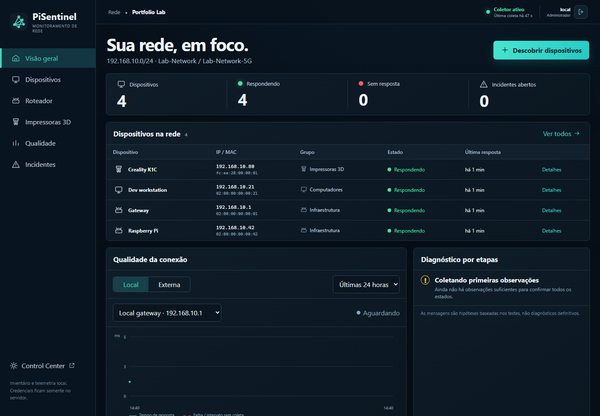
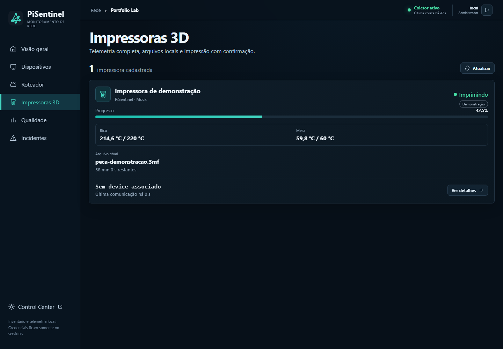
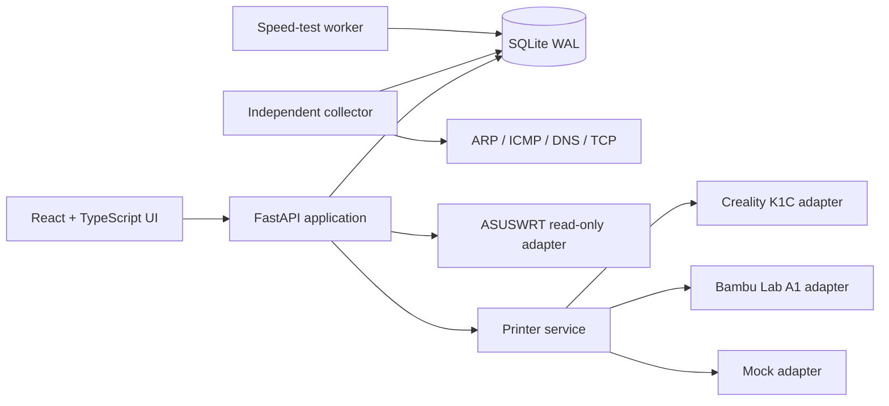

# PiSentinel

[English / README principal](README.md) · Português (Brasil)

[](https://github.com/santosgus3dtech/pi-sentinel/actions/workflows/ci.yml)
[](https://www.python.org/)
[](https://react.dev/)
[](LICENSE)

PiSentinel é um console de operações para Raspberry Pi hospedado pelo próprio usuário, para monitorar uma rede local e gerenciar a telemetria de impressoras 3D em uma única interface web responsiva. Ele combina um backend FastAPI, um coletor de rede independente, armazenamento SQLite em modo WAL e um frontend React/TypeScript.

Este repositório público é uma edição de portfólio com informações sensíveis removidas. Ele não contém banco de dados de produção, credenciais, identificadores de dispositivos ou inventário de rede privado.

## Capturas de tela





As duas telas usam dados sintéticos de portfólio e o adaptador determinístico de impressora simulada.

## Cenário de demonstração reproduzível

Gere um banco de dados local de portfólio com sete dispositivos fictícios, dois alvos monitorados, uma
impressora 3D simulada, um incidente resolvido e uma indisponibilidade ativa:

```bash
python -m pisentinel.demo --output data/demo-pisentinel.db --replace
set PISENTINEL_DB_PATH=data/demo-pisentinel.db
set PISENTINEL_MOCK_PRINTER_ENABLED=true
python -m uvicorn pisentinel.api:app --host 127.0.0.1 --port 8090
```

O gerador usa apenas endereços IP reservados para documentação, endereços MAC administrados localmente e
nomes de dispositivos inventados. Ele se recusa a sobrescrever um banco existente, a menos que `--replace` seja explícito.

## O que demonstra

- Descoberta IPv4 com escopo limitado usando ARP, ICMP, DNS e verificações limitadas de serviços TCP.
- Inventário de dispositivos, enriquecimento com informações de fabricantes, rótulos personalizados, grupos, histórico de disponibilidade e incidentes.
- Telemetria ASUSWRT somente para leitura, com degradação controlada quando o roteador está indisponível.
- Agendamento de testes de velocidade Ookla, histórico de resultados e limites para incidentes.
- Um domínio genérico de impressoras com adaptadores para Creality K1C, Bambu Lab A1 e dados simulados determinísticos.
- Isolamento de credenciais no servidor e validação da impressão digital do certificado para integrações com impressoras.
- Autenticação local, sessões com expiração, respostas conforme o papel do usuário e verificações de mesma origem.
- Unidades de implantação systemd para a API, o coletor e o processo de testes de velocidade.
- Interface React/TypeScript responsiva para operações em computadores e dispositivos móveis.

## Arquitetura



O coletor é responsável pelos ciclos de descoberta e monitoramento. A API nunca inicia uma varredura de rede diretamente; ela apenas coloca uma solicitação na fila do SQLite. As falhas das impressoras são isoladas por adaptador, para que um dispositivo indisponível não derrube o painel.

## Modelo de segurança

PiSentinel foi projetado para uma rede local confiável. Ele não captura pacotes, extrai credenciais, explora dispositivos nem realiza varreduras de vulnerabilidades.

Os comandos físicos para impressoras ficam desabilitados por padrão. Uma solicitação de preparação de impressão é aceita apenas quando todas estas verificações passam:

- autenticação e acesso do navegador pela mesma origem;
- habilitação explícita no servidor;
- arquivo compatível e mesa selecionada;
- estado da impressora exatamente `IDLE` ou `COMPLETED`;
- texto literal de confirmação;
- revalidação final do arquivo, do AMS e do estado da impressora.

Estados desconhecido, offline, imprimindo, pausado ou com erro são rejeitados.

## Desenvolvimento local

Requisitos: Python 3.11+, Node.js 20+ e npm.

```bash
python -m venv .venv
python -m pip install -r requirements-dev.txt

cd frontend
npm ci
npm run build
cd ..

python -m uvicorn pisentinel.api:app --host 127.0.0.1 --port 8090
```

Abra `http://127.0.0.1:8090`. Em um segundo terminal, execute um ciclo seguro do coletor:

```bash
python -m pisentinel.collector --once
```

Copie `.env.example` para `.env` apenas para configuração local. Credenciais reais devem ficar em um arquivo de ambiente ignorado ou em um armazenamento de segredos do serviço, nunca no Git.

## Configuração

O modelo de implantação em `deploy/pisentinel.env.example` usa valores de rede reservados para documentação. Opções importantes incluem:

| Variável | Finalidade | Estado padrão |
| --- | --- | --- |
| `PISENTINEL_AUTH_ENABLED` | Habilita a autenticação local por sessão | Desabilitada para desenvolvimento |
| `PISENTINEL_MOCK_PRINTER_ENABLED` | Adiciona dados determinísticos de impressora simulada | Desabilitada |
| `PISENTINEL_PRINTER_CONTROLS_ENABLED` | Permite a preparação de impressão com verificações de segurança | Desabilitada |
| `PISENTINEL_ROUTER_*` | Configura a telemetria do roteador somente para leitura | Vazio |
| `BAMBU_A1_*` | Configura a integração local com Bambu | Vazio |

Veja `docs/` para notas sobre autenticação, telemetria do roteador, adaptadores de impressoras, descoberta segura da K1C, testes de velocidade e design da interface.

## Verificação

```bash
python -m pytest -q -p no:cacheprovider
cd frontend && npm ci && npm run build
```

O GitHub Actions executa as duas suítes a cada push e pull request.

## Implantação

Unidades systemd de exemplo para Raspberry Pi OS estão disponíveis em `deploy/`. A estrutura prevista para produção é:

- aplicação: `/opt/pi-sentinel`;
- banco de dados persistente: `/var/lib/pi-sentinel/pisentinel.db`;
- configuração privada: `/etc/pi-sentinel/pisentinel.env`.

Ambientes de produção devem executar atrás de um proxy reverso local confiável ou de uma VPN, usar autenticação, proteger as permissões da configuração e manter os controles das impressoras desabilitados até que sejam configurados deliberadamente.

## Licença

MIT. Veja [LICENSE](LICENSE).
